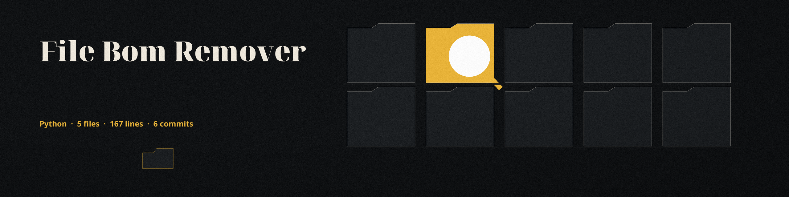

# file-bom-remover
Detects and removes Byte Order Marks (BOMs) from the beginning of text-based files. Supports UTF-8, UTF-16LE, and UTF-16BE. Useful for preventing encoding issues and ensuring file compatibility. Can operate recursively on directories. - Focused on File operations and analysis

## Install
`git clone https://github.com/ShadowStrikeHQ/file-bom-remover`

## Usage
`./file-bom-remover [params]`

## Parameters
- `-h`: Show help message and exit
- `-e`: No description provided
- `-r`: No description provided
- `-v`: No description provided

## License
Copyright (c) ShadowStrikeHQ

Every run reports the number of byte order marks removed, as `BOMs removed: N`. A missing file or directory exits 1. A run that removes nothing exits 1 with a plain nothing removed line, so a nothing run is distinguishable from a worked run.
